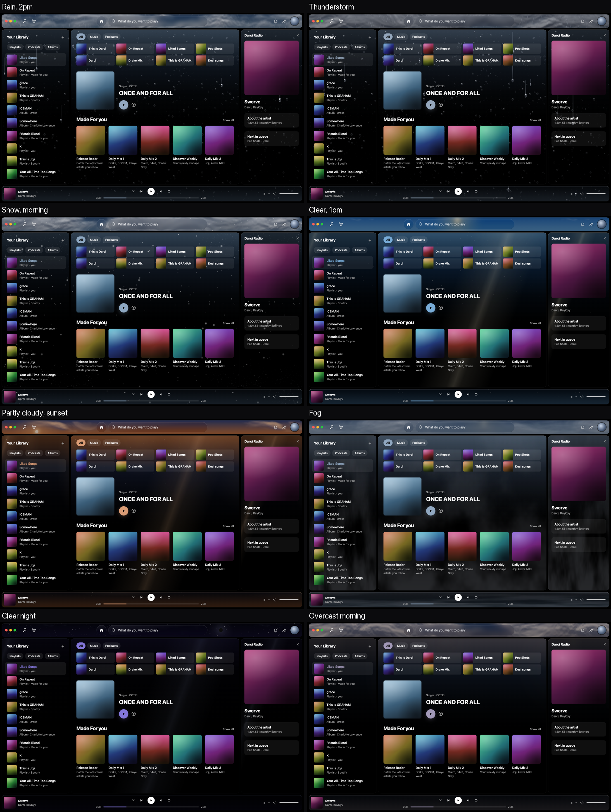
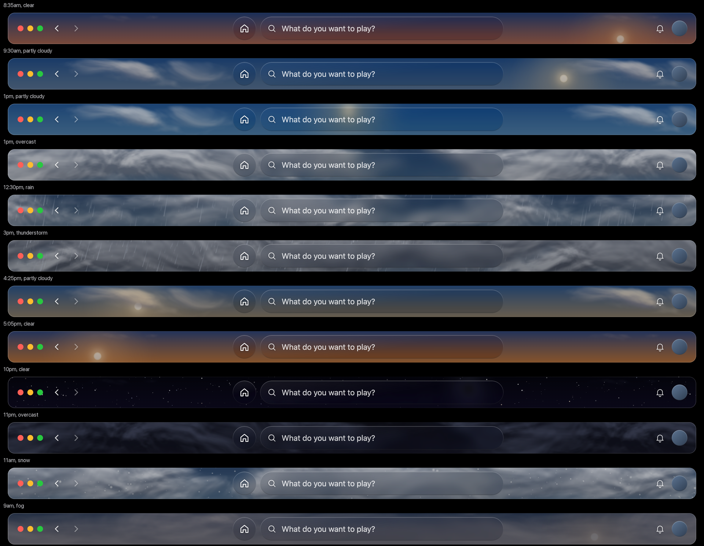

# PureBlack

A Spicetify theme for Spotify on macOS. Pure black with Apple-style liquid glass, and every color taken from the real sky outside.



## What it does

- **Live sky in the top bar.** Clouds at two depths, sun and moon on their real paths (with the moon's real phase), stars at night. Rain, snow, fog and thunderstorms come from the current weather.
- **Sky-lit glass on the panels.** The library, main view, right sidebar and playbar get a wash of the sky's color from the top, and their edges pick up the light.
- **Weather on the glass, in motion.**

  | Weather | What happens on the panels |
  |---|---|
  | Rain, drizzle | Real-looking water across the whole window: dense irregular drops that merge, run, stall and dry, leaving thin wet tracks |
  | Thunderstorm | Heavier water, and lightning that shows through every panel and lights up every drop, in time with the top bar |
  | Snow | Flakes drift down; frost forms at the corners |
  | Clear or partly cloudy | A sun glint sweeps across; dust floats in the light (a moon glint at night) |
  | Fog | Mist drifts across the lower half |

- **One source of color.** Buttons, chips, the progress bar and hovers follow the sky's color: blue on a clear day, steel grey in rain, rose at dusk, indigo at night.
- **Details.** One radius scale everywhere, a taller top bar with the window buttons kept centred, a playbar glow that pulses while music plays, and Spotify's lyrics button opening Lyrics Plus.



## How it works

- `theme.js` works out the sunrise and sunset for your timezone's location (NOAA formula, coordinates from macOS's `zone.tab`). It then builds the sky colors for the current time and weather and sets them as CSS variables.
- Weather comes from [Open-Meteo](https://open-meteo.com) (no API key), checked every 30 minutes and cached in `localStorage` under `pureblack:sky-weather`.
- Clouds, flakes and dust are drawn once into canvas tiles. After that, only `transform` and `opacity` animate, so nothing is redrawn every frame.
- Rain is a small water simulation drawn with WebGL2. Each drop works as a lens showing an upside-down image of the current sky. It only runs while it's raining. If WebGL2 isn't available, the theme falls back to simpler animated drops.
- Everything pauses while Spotify is hidden and respects Reduce Motion.
- Spotify paints its panel content solid black, so the sky wash is a screen-blended `::after`. The weather layer (`.pb-glass`) sits above the content and ignores clicks.

## Install with an agent

Send your coding agent (Claude Code, Codex, Cursor, …) this:

> Install the Spotify theme at https://github.com/xenshreyas/pureblack-spicetify by following its AGENTS.md.

[AGENTS.md](AGENTS.md) walks the agent through everything from a fresh Mac: Spotify, Spicetify, permissions, the theme, and a check that it worked. It tells the agent to hand back to you the parts only you should do: signing in to Spotify and any `sudo` command.

## Install by hand

Needs Spotify (opened and signed in once) and [Spicetify](https://spicetify.app) (built against v2.46.4; `brew install spicetify-cli`).

```bash
./install.sh
```

To also reapply automatically after Spotify updates itself (a LaunchAgent that watches Spotify's app folder):

```bash
./install.sh --auto-reapply
```

## Preview other weather and times

Turn on devtools (`spicetify enable-devtools`), then in the console:

```js
PureBlackSky.setWeather("storm")   // clear, partly, cloudy, drizzle, rain, storm, snow, fog
PureBlackSky.setHour(21)           // any hour, 0–24
PureBlackSky.setWeather()          // no argument = back to live
PureBlackSky.setHour()
```

## Editing

The live copy Spicetify reads is `~/.config/spicetify/Themes/PureBlack/`. After editing it there:

```bash
./sync.sh        # copy the live files back into this repo
```

Then commit. Or edit here and run `./install.sh`.

Many selectors target Spotify's hashed class names (for example `.EmXZMILXH0bP7U461Va6` for the top bar). If a Spotify update renames one, find the new name by grepping `/Applications/Spotify.app/Contents/Resources/Apps/xpui/*.css`.

## Layout

| Path | What |
|---|---|
| `theme/PureBlack/` | `color.ini`, `user.css`, `theme.js` |
| `extensions/lyrics-plus-button.js` | Makes Spotify's lyrics button open Lyrics Plus |
| `auto-reapply/` | Reapply script and LaunchAgent template |
| `AGENTS.md` | Step-by-step install guide for coding agents (`CLAUDE.md` points to it) |
| `prototypes/` | Standalone HTML prototypes used to pick the design (open in a browser) |
| `docs/renders/` | Renders of the theme in a mock Spotify layout |
